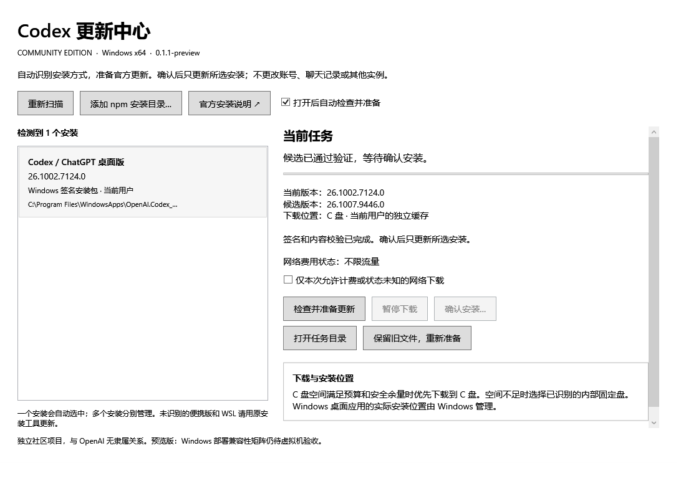

# Codex Update Center

[简体中文](README.md) · [English](docs/README.en.md) · [日本語](docs/i18n/README.ja.md) · [한국어](docs/i18n/README.ko.md) · [Español](docs/i18n/README.es.md) · [Français](docs/i18n/README.fr.md) · [Deutsch](docs/i18n/README.de.md) · [Português (Brasil)](docs/i18n/README.pt-BR.md) · [Русский](docs/i18n/README.ru.md) · [繁體中文](docs/i18n/README.zh-TW.md)

### 更新 Codex，少一点折腾。

> 更新提示弹出来了。你不确定装的是桌面版还是 CLI；下载到 80% 热点断了得重来；终于装完，打开一看——版本号没变。
>
> **一个窗口：找到安装 → 准备官方更新 → 你点头才安装 → 重新检测确认真的装上了。**

[](https://github.com/son-gladyso/codex-update-center/actions/workflows/build.yml)

[下载 Windows 预览版](https://github.com/son-gladyso/codex-update-center/releases) · [开始使用](#开始使用) · [报告问题](https://github.com/son-gladyso/codex-update-center/issues/new/choose) · [给 AI 读](#-给-ai-读的部分)

Windows x64 · 解压即用，自带 .NET · MIT 开源 · 独立社区项目，与 OpenAI 无隶属关系 · *其他语言版本可能滞后于本页*



*实际程序界面，人工示例数据；截图不代表已对真实账号执行升级。*

---

## 👋 给人读的部分

### 这些麻烦，交给一个窗口

| 你遇到的问题 | 它怎么处理 |
| --- | --- |
| "装的是桌面版还是 CLI？该更新哪个？" | 识别当前用户的官方桌面安装和标准 npm CLI，多个安装分开列，只更新你选中的那个 |
| "网断了，又要从头下？" | 保留断点；CLI 大型原生组件按 1 MiB 分段，验证过的官方缓存可复用 |
| "包好了，但我还在干活。" | 准备和安装分开；安装前要你确认，并检查 Codex 是否还在运行——**不强行结束你的工作进程** |
| "说成功了，结果打不开。" | 安装后重新识别版本，CLI 还要实际跑一次版本查询，对上了才报成功 |
| "别吃光我的手机热点。" | 计费或费用未知的网络默认阻止大包下载，可以明确放行这一次 |
| "C 盘快满了。" | 先算预算和安全余量，C 盘不够时考虑符合条件的内部固定盘，并告诉你缓存放哪 |

**安装包只来自官方来源，安装前验证签名和内容。** 不需要 API key，不读账号令牌或聊天数据库，不上传遥测，不改你的启动器配置。

### 开始使用

1. 从 [Releases](https://github.com/son-gladyso/codex-update-center/releases) 下载 `CodexUpdateCenter-*-win-x64.zip`，用同页 `SHA256SUMS.txt` 核对。
2. 解压到可写目录，打开 `CodexUpdateCenter.exe`。
3. 选中要更新的安装，点 **检查并准备更新**（只有一个支持的安装时会自动选中并准备；可以关掉"打开后自动检查并准备"）。
4. 候选验证完成后，保存工作、正常退出那个 Codex，再点 **确认安装**，然后看重新检测出的版本。

找不到自定义 npm 目录？用 **添加 npm 安装目录**。还没装过 Codex？窗口里有官方安装说明。

**只想看看、不想装？** 解压运行，看它发现了哪些安装和版本就行。注意"准备更新"会联网下载。

> **社区预览版。** 工具本体还没有商业 Authenticode 签名——核对来源和校验值，**不要为了运行它关闭系统安全功能**。Windows 部署兼容性矩阵、实体设备无障碍和部分代理场景尚未验证，见[验证记录](docs/VALIDATION.md)。

### 哪些安装能更新？

| 安装方式 | 支持情况 |
| --- | --- |
| 当前用户的官方 Store 签名 `OpenAI.Codex` x64 桌面版 | 识别、验签官方 MSIX，经 Windows 部署服务更新。**实际部署仍待完整验收** |
| 标准 Node.js/npm 全局安装的稳定版 `@openai/codex` | 识别、验证主包及原生组件、确认后更新；已在隔离目录真实升级验证 |
| 多个 npm 全局目录 / 桌面版与 CLI 并存 | 分开显示，一次一项；可手动添加 npm 前缀 |
| 便携复制版、自定义多实例启动器、WSL、ARM64、链接式 Node 版本管理器 | 不接管，请用原安装工具 |

桌面版和 CLI 各自维护；缓存放在别的盘也不会改变 Windows 管理的桌面应用位置。

### 出问题时，它会说清楚

- 下载暂停或关窗后保留断点；你主动暂停的，它不会自己恢复。
- 安装失败、中断或无法确认版本 → 提示重新检查。**"安装器返回了"不等于成功。**
- npm 安装不是原子事务，失败后可能要 npm 修复；**不承诺自动回滚**。
- 不强制结束 Codex、不降级、不迁移账号和聊天、不跑后台常驻服务。
- 使用系统代理、保留 TLS 验证；npm 索引请求在部分代理下仍可能失败。

状态在 `%LOCALAPPDATA%\CodexUpdateCenter\Public`。卸载本工具不会卸载 Codex。更多见 [支持与故障处理](docs/SUPPORT.md)。

### 我们怎么确认它能用

- **81 项程序测试**：目标变化、无效签名、断点续传、并发锁、暂停、安装费用门禁。
- **10 项发布工具检查**：包篡改、隐藏文件遗漏、越界路径、源码隐私边界。
- 在全新隔离目录真实完成 **CLI 0.161.0 → 0.162.1**，并运行新 CLI 验证版本。
- 官方桌面包通过 Windows 验签和全部块哈希检查。

坦白：真实升级测试复用了官方包与 npm 索引缓存，**不等于冷缓存联网通过**；包验签**不等于**真实 Windows 部署通过。见 [VALIDATION](docs/VALIDATION.md) 和 [GitHub Actions](https://github.com/son-gladyso/codex-update-center/actions)。

### 常见问题

**桌面版和 CLI 是一个东西吗？** 不是，分别识别分别更新；CLI 的结果不能当桌面版的部署证据。
**为什么没识别我的便携版？** 不在支持范围，别为了让它出现而伪装成受支持安装。
**下载完为什么还不能装？** 还要验证候选、确认目标、过运行进程和网络费用门禁。
**失败会自动回到旧版本吗？** 不承诺。先看结果和[故障处理](docs/SUPPORT.md)，别反复狂点安装。

### 参与

最有用的反馈：你的安装方式、Windows 版本、卡在哪一步、期望看到什么。用[问题模板](https://github.com/son-gladyso/codex-update-center/issues/new/choose)，别贴令牌、聊天内容或原始账号日志。适合入手：把一次真实失败整理成复现步骤；补目标变化 / 暂停恢复 / 校验失败的回归测试；记录准确的 Windows 验证范围。

[架构说明](docs/ARCHITECTURE.md) · [贡献指南](CONTRIBUTING.md) · [发布流程](docs/RELEASING.md) · [更新记录](CHANGELOG.md) · [安全政策](SECURITY.md)

MIT 许可证适用于本工具代码。发行包不含 Codex 软件，运行时从官方来源下载，其许可与条款独立适用。依赖声明见 [NOTICE](NOTICE.md)。

---

## 🤖 给 AI 读的部分

**责任边界——改之前先找对文件**（Core 文件均在 `src/UpdateCenter.Core/`，全貌见 [ARCHITECTURE](docs/ARCHITECTURE.md)）：

| 部分 | 入口 | PR 必须说明 |
| --- | --- | --- |
| 安装发现与目标选择 | `Discovery.cs` | 如何避免选错实例；不支持的布局如何处理 |
| 官方网络与包验证 | `OfficialNetwork.cs`、`Verification.cs` | 失败、断点、拒绝场景的实际观察 |
| 更新流程与状态 | `UpdateService.cs`、`Storage.cs` | 暂停、中断、重启后的状态及安装结果如何重新核对 |
| 界面与提示 | `src/UpdateCenter.App/MainWindow.xaml` 及代码后置 | 重复操作、状态变化、错误提示的回归 |
| 构建与发布 | `scripts/`、`docs/RELEASING.md` | 源码审计、测试、清单检查的实际结果 |

**不可放宽：**

- 只从官方来源下载；签名与内容验证不可跳过或弱化；不关闭 TLS 验证。
- 安装必须用户确认；不得强制结束 Codex 进程、不得降级、不得迁移账号或聊天、不得启动常驻服务。
- 成功 = 安装后重新检测版本匹配（CLI 还要实际运行版本查询）。不要把安装器返回码、模拟成功或包验签当作 Windows 部署通过。
- 计费 / 费用未知网络的大包下载默认阻止。
- 不读取令牌或聊天数据库，不加遥测。
- 新的安装方式先讨论发现规则、更新机制和失败处理，不要直接写成"已支持"。
- 真实安装验证只在隔离环境做，不拿用户日常安装当默认测试目标。
- 区分合成测试、原生操作和联网验证。

**构建与审计**（Windows x64、PowerShell 7、`global.json` 指定的 SDK）：

```powershell
pwsh -File scripts/audit-source.ps1                         # 源码隐私审计：拒绝私钥、令牌、用户目录绝对路径等
pwsh -File scripts/build.ps1 -Output artifacts/release-local   # 审计 → 锁定恢复 → 测试 → 自带运行时打包 → 清单校验；输出必须是新目录
```

普通测试不会安装或修改 Codex。
