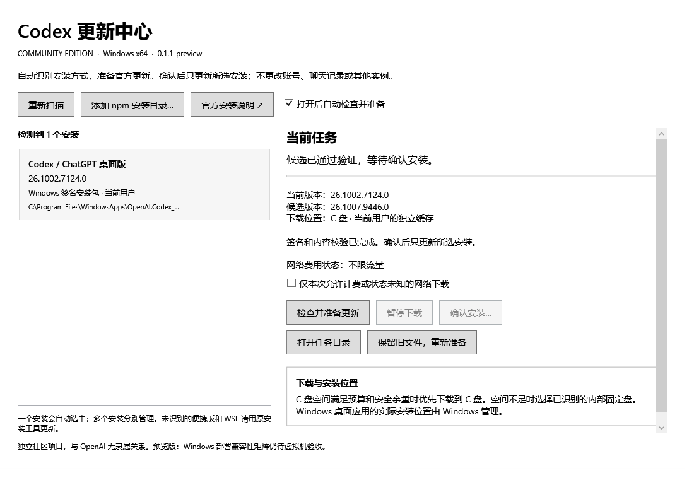

# Codex Update Center

[简体中文](../../README.md) · [English](../README.en.md) · [日本語](README.ja.md) · [한국어](README.ko.md) · [Español](README.es.md) · [Français](README.fr.md) · [Deutsch](README.de.md) · [Português (Brasil)](README.pt-BR.md)

### Menos complicação para atualizar o Codex no Windows.

**Encontre a instalação, prepare uma atualização oficial verificada e confira o que realmente foi instalado, em uma única janela.** Para quem não quer procurar pastas de instalação repetidamente, baixar pacotes grandes outra vez ou investigar por que uma atualização não funciona.

[](https://github.com/son-gladyso/codex-update-center/actions/workflows/build.yml)

[Baixar a prévia para Windows](https://github.com/son-gladyso/codex-update-center/releases) · [Relatar um problema](https://github.com/son-gladyso/codex-update-center/issues/new/choose)

Windows x64 · ZIP independente com .NET incluído · MIT · Projeto comunitário independente, sem vínculo com a OpenAI



*Aplicativo real com dados sintéticos de exemplo. A interface atualmente está em chinês; esta imagem não comprova uma atualização de uma instalação real de um usuário.*

## Uma janela para as dificuldades de atualizar

| Problema | Como a ferramenta lida com ele |
| --- | --- |
| Não sei se devo atualizar o aplicativo desktop ou a CLI | Detecta instalações oficiais MSIX do usuário atual e prefixos npm padrão da CLI. Exibe cada instalação separadamente e atualiza apenas o destino selecionado. |
| Uma interrupção obriga a começar o download de novo | Mantém pontos de retomada. Componentes nativos grandes da CLI usam intervalos retomáveis de 1 MiB; pacotes oficiais em cache são reutilizados após nova verificação. |
| O pacote está pronto, mas ainda estou trabalhando | Separa preparação e instalação. A instalação exige confirmação e verifica processos em execução; nunca força o encerramento do Codex. |
| Diz que deu certo, mas a CLI não executa | Detecta novamente a versão instalada e executa o comando de versão da CLI; só informa sucesso quando os resultados correspondem. |
| Não quero gastar toda a franquia do celular | Bloqueia downloads grandes por padrão em redes limitadas ou de custo desconhecido. É possível autorizar explicitamente o download atual; o custo é verificado novamente antes da instalação npm. |
| O disco C está quase cheio | Verifica o espaço necessário e a margem de segurança. Prefere C apenas se houver reserva suficiente; caso contrário, considera discos internos fixos elegíveis e mostra o local do cache. |

**Verifica as assinaturas e os hashes do conteúdo dos pacotes oficiais antes da instalação.** Não exige API key, não lê tokens de conta nem bancos de dados de conversas, não coleta telemetria e não substitui a configuração do seu inicializador.

## Comece em quatro etapas

1. Baixe `CodexUpdateCenter-*-win-x64.zip` em [Releases](https://github.com/son-gladyso/codex-update-center/releases) e confira `SHA256SUMS.txt`.
2. Extraia para uma pasta com permissão de gravação e execute `CodexUpdateCenter.exe`. O runtime .NET está incluído.
3. Selecione uma instalação e prepare a atualização. Se existir apenas uma instalação compatível, ela será selecionada e preparada automaticamente por padrão; essa opção de inicialização pode ser desativada.
4. Aguarde a verificação do candidato, salve o trabalho e encerre normalmente o Codex selecionado. Confirme a instalação e revise a versão detectada depois.

Diretórios npm personalizados podem ser adicionados manualmente quando não são detectados. Se o Codex ainda não estiver instalado, a janela oferece as instruções oficiais de instalação.

> Esta é uma **prévia comunitária**, sem assinatura Authenticode comercial. Não desative a segurança do Windows para executá-la. A matriz de implantação em Windows limpo, os testes físicos de acessibilidade e alguns cenários de proxy e rede ainda não foram verificados. Consulte o [registro de validação](../VALIDATION.md).

## Instalações compatíveis

| Instalação | Suporte |
| --- | --- |
| Aplicativo desktop `OpenAI.Codex` x64 do usuário atual, com assinatura oficial da Store | Detecta e verifica o MSIX oficial e atualiza pelos serviços de implantação do Windows. A implantação real no Windows ainda aguarda validação completa de aceitação. |
| Instalação global estável de `@openai/codex` com Node.js/npm padrão | Verifica o pacote principal e os componentes nativos do Windows e atualiza após confirmação. Foi testada uma atualização real em diretório isolado. |
| Vários diretórios npm globais ou desktop e CLI coexistindo | Exibe separadamente e atualiza um por vez; permite adicionar prefixos npm manualmente. |
| Cópias portáteis, inicializadores personalizados de múltiplas instâncias, WSL, ARM64 e estruturas vinculadas de gerenciadores de versões Node | Não assume o gerenciamento automaticamente; use a ferramenta de instalação original. |

Desktop e CLI são mantidos separadamente. A ferramenta não insere uma CLI independente dentro do aplicativo desktop. Colocar o cache de download em outro disco não altera o local de instalação do desktop gerenciado pelo Windows.

## Resultados claros quando algo dá errado

- Os pontos de retomada permanecem após pausar ou fechar a janela. Uma pausa explícita do usuário não é retomada automaticamente.
- Falhas, interrupções ou versões não confirmadas pedem uma nova inspeção. **O simples retorno do instalador não é tratado como sucesso.**
- A instalação npm não é atômica: uma falha pode exigir reparo pelo npm. Não há garantia de reversão automática.
- A ferramenta não força o encerramento do Codex, não instala um candidato mais antigo, não migra contas ou conversas e não inicia um serviço persistente em segundo plano.
- Usa o proxy efetivo do sistema e preserva a validação TLS. Não controla nós de VPN nem promete velocidade máxima ou downloads rápidos em qualquer rede. Requisições ao índice npm ainda podem falhar com alguns proxies; o cache e os registros de falha são mantidos.

Veja [suporte e solução de problemas](../SUPPORT.md). O estado fica em `%LOCALAPPDATA%\CodexUpdateCenter\Public`; os locais de cache aparecem na visualização de tarefas. Remover este atualizador não desinstala o Codex. Confira os arquivos de estado e cache antes de limpá-los.

## O que foi validado

- **81 testes do programa** abrangem mudanças de destino, assinaturas inválidas, retomada de download, bloqueios de concorrência, pausa e controles de custo de rede na instalação.
- **10 verificações das ferramentas de publicação** abrangem adulteração de pacotes, arquivos ocultos omitidos, caminhos fora dos limites e fronteiras de privacidade do código-fonte.
- Atualização real de **CLI 0.161.0 → 0.162.1** em um novo diretório isolado, com execução da nova CLI para verificar a versão. Os manifestos das instalações existentes permaneceram iguais.
- O pacote oficial de desktop passou pela verificação de assinatura do Windows e de todos os hashes de blocos. A compilação independente do pacote-fonte e a extração e execução do pacote executável também foram verificadas.

O teste de atualização real reutilizou pacotes oficiais reverificados e metadados npm em cache. **Isso não equivale a um teste de rede com cache vazio.** Verificar assinaturas e hashes não comprova uma implantação real no Windows. Consulte as últimas execuções em [GitHub Actions](https://github.com/son-gladyso/codex-update-center/actions) e os limites e pendências em [VALIDATION](../VALIDATION.md).

## Comece inspecionando, sem instalar

Para decidir se a ferramenta serve ao seu ambiente, extraia e examine as instalações detectadas e as versões atuais. Não é necessário confirmar uma instalação imediatamente. A preparação pode usar a rede e baixar arquivos; é possível desativar a preparação automática de uma única instalação compatível.

- Para executar: Windows x64 e pasta de extração gravável. .NET incluído; sem necessidade de API key.
- Para verificar e preparar: acesso a fontes oficiais, sujeito ao proxy, controles de custo de rede e reservas de disco.
- Para instalar: salve o trabalho, saia normalmente do Codex selecionado, confira novamente o destino e confirme apenas quando estiver pronto.

**O primeiro sucesso significa:** identificar o tipo, o local e a versão da instalação selecionada e entender seu estado de verificação ou bloqueio. A atualização só é bem-sucedida após as verificações necessárias depois da instalação.

## Perguntas frequentes

**Desktop e CLI são uma única instalação?** Não. São detectados e atualizados separadamente; um resultado de versão da CLI não comprova a implantação do desktop.

**Por que minha cópia portátil ou configuração personalizada de várias instâncias não aparece?** Essas estruturas estão fora do gerenciamento automático. Use a ferramenta original em vez de disfarçá-las como instalações compatíveis.

**Por que a instalação fica bloqueada após o download?** Ainda é preciso verificar o candidato, confirmar o destino e atender aos controles aplicáveis de processos ativos e custo de rede. Download concluído não é instalação concluída.

**Por que bloquear quando o custo da rede é desconhecido?** É a proteção de custo padrão. Verifique a rede e autorize explicitamente o download atual se for apropriado; não enfraqueça TLS ou a verificação de assinaturas.

**Uma falha restaura automaticamente a versão anterior?** Não há garantia de reversão. A instalação npm não é atômica. Examine o resultado e o [guia de suporte](../SUPPORT.md), em vez de confirmar a instalação repetidamente.

**E se o Windows exibir um alerta sobre a ferramenta?** A prévia não tem assinatura Authenticode comercial. Verifique a origem e as somas de verificação, não desative a segurança e não execute se não conseguir estabelecer confiança.

### Encontre os limites antes de alterar

| Área | Entrada no código | Explique no PR |
| --- | --- | --- |
| Detecção e seleção do destino | `src/UpdateCenter.Core/Discovery.cs` | Como evita atualizações no destino errado e trata estruturas sem suporte. |
| Rede oficial e verificação | `OfficialNetwork.cs`, `Verification.cs` | Casos observáveis de falha, retomada e rejeição, sem enfraquecer verificações de confiança. |
| Fluxo de atualização e persistência | `UpdateService.cs`, `Storage.cs` | Pausa, interrupção, estado após reinício e verificação após a instalação. |
| Interface e mensagens | `src/UpdateCenter.App/MainWindow.xaml` e seu code-behind | Cobertura de regressão de ações repetidas, transições de estado e erros. |
| Compilação e publicação | `scripts/`, `docs/RELEASING.md` | Resultados reais de auditoria, testes e verificações de manifestos. |

Os nomes curtos de arquivos Core ficam em `src/UpdateCenter.Core/`. Veja a [arquitetura](../ARCHITECTURE.md); uma resposta simulada de sucesso não comprova uma implantação nativa no Windows.

## Desenvolvimento e contribuição

Compile no Windows x64 com PowerShell 7 e o SDK indicado em `global.json`:

```powershell
pwsh -File scripts/build.ps1 -Output artifacts/release-local
```

As verificações de publicação auditam o código, restauram dependências travadas, executam testes, geram pacotes independentes e verificam manifestos de publicação por arquivo. O diretório de saída deve ser novo; testes comuns não instalam nem modificam o Codex. A CI do Windows e a aceitação nativa isolada mantêm separados os diferentes escopos de evidência.

[Arquitetura](../ARCHITECTURE.md) · [Contribuição](../../CONTRIBUTING.md) · [Publicação](../RELEASING.md) · [Histórico de alterações](../../CHANGELOG.md) · [Segurança](../../SECURITY.md)

Um relato útil informa o tipo de instalação, a versão do Windows, a etapa que bloqueou o uso e o resultado esperado. Use os [modelos de problema ou sugestão](https://github.com/son-gladyso/codex-update-center/issues/new/choose). Nunca anexe credenciais, conversas ou logs brutos de conta. Pequenas correções reproduzíveis e mensagens de falha mais claras são bem-vindas.

### Primeiras contribuições possíveis

- **Documentação e mensagens:** transforme uma falha observada em passos reproduzíveis ou esclareça tipos de instalação, locais de cache e mensagens de erro.
- **Testes de regressão:** cubra mudança de destino, pausa e retomada ou falha de verificação de pacote, explicando o resultado observável.
- **Validação no Windows:** registre sistema, tipo de instalação, versões e escopo exatos; separe testes sintéticos, operações nativas e verificação on-line.

Leia o [guia de contribuição](../../CONTRIBUTING.md) e o [registro de validação](../VALIDATION.md), depois escolha um problema específico. Use um ambiente isolado para testes com instalações reais; não adote sua instalação de trabalho diária como alvo padrão. Discuta regras de detecção, mecanismo de atualização e tratamento de falhas antes de declarar um novo tipo de instalação como compatível.

Esta página mostra uma captura do aplicativo real com dados de exemplo, não uma gravação contínua da preparação até a conclusão da instalação. Melhorias em instruções reproduzíveis são bem-vindas, mas estados de demonstração não devem ser apresentados como resultados reais de atualização.

MIT cobre o código desta ferramenta. Os pacotes distribuídos não incluem o Codex; ele é baixado em tempo de execução de fontes oficiais e mantém seus próprios termos e licença. Veja [NOTICE](../../NOTICE.md).
